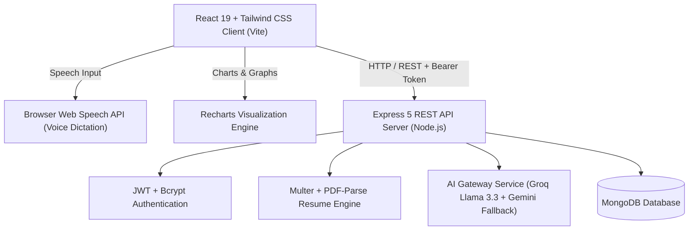

# 🚀 CareerPilot-AI: Autonomous AI-Powered Career Engineering Platform

> **Major Project / Final Year Capstone Engineering Project**  
> A full-stack MERN + Generative AI platform designed to empower students and tech professionals in acing their job hunts through voice-enabled mock interviews, ATS resume optimization, targeted job matching, and full-cycle application pipeline management.

---

## 📌 Table of Contents
1. [Overview](#-overview)
2. [Key Innovations & Features](#-key-innovations--features)
3. [System Architecture](#-system-architecture)
4. [Tech Stack](#-tech-stack)
5. [Project Structure](#-project-structure)
6. [Installation & Setup Guide](#-installation--setup-guide)
7. [Environment Variables](#-environment-variables)
8. [API Documentation](#-api-documentation)
9. [Major Project Report](#-major-project-report)

---

## 🌟 Overview
In modern tech hiring, job seekers face high rejection rates due to non-optimized resumes failing ATS screening, lack of practical real-time interview practice with constructive feedback, and disorganized application tracking across various platforms.

**CareerPilot-AI** bridges these gaps by providing an integrated, AI-driven career suite that:
- Conducts **Speech-to-Text AI Mock Interviews** with live per-answer scoring and ideal model answers.
- Parses PDF resumes to deliver an **ATS Score**, identifies missing keywords, and tailors experience bullets directly against target Job Descriptions.
- Auto-generates customized **Cover Letters** and **LinkedIn Cold Outreach** notes.
- Delivers an interactive **Kanban Application CRM** to organize job leads and follow-ups.
- Features a real-time **AI Career Copilot** accessible anywhere in the platform.

---

## ⚡ Key Innovations & Features

### 1. 🎙️ AI Voice Mock Interview & Real-Time Evaluator
- **Hands-Free Voice Answering**: Powered by browser native Web Speech API (`SpeechRecognition`) for natural dictation.
- **Answer Timer**: Simulated 2-minute countdown timer to emulate real interview pressure.
- **Per-Answer Instant Evaluation**: Computes Technical Accuracy, Communication Clarity, and Confidence ratings.
- **Model Answer Reveal**: Generates what an ideal candidate would say for each question.
- **Comprehensive Scorecard**: Final summary with radar/breakdown metrics, key strengths, areas for improvement, and action items.

### 2. 📄 ATS Resume Scanner & JD Matcher
- **Deep PDF Text Parsing**: Uses `pdf-parse` to analyze formatting and keyword density.
- **ATS Compatibility Score**: Quantitative score (0-100) with detailed strengths and weaknesses.
- **Target Job Description Matcher**: Compares candidate's resume with a pasted job description, calculates Match %, and generates AI-tailored bullet points with quantifiable impact.
- **AI Cover Letter & Outreach Generator**: One-click generation of tailored cover letters and LinkedIn messages tailored to company and role.

### 3. 📊 Interactive Kanban Job Application CRM
- **Dual Views**: Interactive Kanban Board (Applied, Shortlisted, Interview, Selected, Rejected) + Detailed Table View.
- **External Application Logging**: Log external jobs applied on LinkedIn, Indeed, or career portals with salary, interview dates, priority tags, and custom notes.
- **Funnel Analytics**: Real-time charts powered by Recharts visualizing pipeline conversion rates.

### 4. 🗺️ Dynamic Career Roadmaps
- Customized phase-by-phase curriculum (Foundational to Job-Ready) generated dynamically for any target tech role.
- Step-by-step progress tracking, duration estimates, practical portfolio projects, and curated learning topics.

### 5. 🤖 Floating AI Career Copilot
- Always-available AI mentor floating widget across all pages.
- One-click prompt chips for behavioral tips, salary negotiation, STAR method templates, and technical questions.

---

## 🏗️ System Architecture



---

## 💻 Tech Stack

| Layer | Technologies |
| :--- | :--- |
| **Frontend** | React 19, Vite, Tailwind CSS v4, Redux Toolkit, React Router v7, Recharts, Lucide React |
| **Speech Engine**| Web Speech Recognition API (`SpeechRecognition` / `webkitSpeechRecognition`) |
| **Backend** | Node.js, Express 5.x, JWT (`jsonwebtoken`), Multer, PDF-Parse, Helmet, CORS |
| **AI Orchestration** | Groq SDK (`llama-3.3-70b-versatile`), Google Generative AI (`gemini-2.0-flash`) |
| **Database** | MongoDB & Mongoose ORM |

---

## 📁 Project Structure

```
CareerPilot-AI/
├── client/
│   ├── src/
│   │   ├── components/
│   │   │   ├── CareerCopilotModal.jsx  # Floating AI Career Advisor
│   │   │   ├── ProtectedRoute.jsx      # Route guard + AI Copilot injector
│   │   │   ├── Sidebar.jsx             # Navigation sidebar
│   │   │   └── StatCard.jsx            # Dynamic KPI display cards
│   │   ├── pages/
│   │   │   ├── Home.jsx                # High-converting SaaS Landing Page
│   │   │   ├── Dashboard.jsx           # Analytics & Live Funnel Charts
│   │   │   ├── MockInterview.jsx       # Voice AI Interview & Scorecard
│   │   │   ├── ResumeAnalyzer.jsx      # ATS Scanner, JD Matcher, Cover Letter
│   │   │   ├── ApplicationTracker.jsx  # Kanban CRM & Pipeline Manager
│   │   │   ├── CareerRoadmap.jsx       # Dynamic Role Roadmaps
│   │   │   ├── SkillGap.jsx            # Skill Gap Comparison
│   │   │   ├── Jobs.jsx                # Job Match Explorer
│   │   │   └── Profile.jsx             # Candidate Profile & Credentials
│   │   ├── redux/                      # Redux Toolkit Auth Store
│   │   └── services/api.js             # Axios Client with JWT Interceptors
│   └── package.json
├── server/
│   ├── config/db.js                    # MongoDB Connection
│   ├── controllers/                    # Business logic controllers
│   ├── models/                         # Mongoose Models (User, Resume, MockInterview, Application, Job)
│   ├── routes/                         # Express API route modules
│   ├── services/
│   │   ├── aiGateway.js                # Groq + Gemini unified AI gateway
│   │   ├── mockInterviewService.js     # Interview question & answer evaluation
│   │   ├── geminiService.js            # Resume analysis, JD match, Cover letters
│   │   └── careerInsightService.js     # Executive career advice generator
│   ├── server.js                       # Express Application Entry Point
│   └── package.json
├── MAJOR_PROJECT_REPORT.md             # Complete Academic & Engineering Report
└── README.md
```

---

## 🛠️ Installation & Setup Guide

### 1. Prerequisites
- Node.js (v18.x or v20.x recommended)
- MongoDB running locally (`mongodb://localhost:27017/careerpilot`) or MongoDB Atlas URI
- API Key from [Groq Console](https://console.groq.com) or [Google AI Studio](https://aistudio.google.com)

### 2. Clone & Install Dependencies
```bash
# Clone the repository
git clone <your-repository-url>
cd CareerPilot-AI

# Install server dependencies
cd server
npm install

# Install client dependencies
cd ../client
npm install
```

### 3. Setup Environment Variables
Create a `.env` file in the `server` directory:
```env
PORT=5000
MONGO_URI=mongodb://localhost:27017/careerpilot
JWT_SECRET=your_jwt_super_secret_key_change_in_production
GROQ_API_KEY=your_groq_api_key_here
GEMINI_API_KEY=your_gemini_api_key_here
```

### 4. Seed Initial Job Data (Optional)
```bash
cd server
node seedJobs.js
```

### 5. Run the Application
In terminal 1 (Start Server):
```bash
cd server
npm run dev
```

In terminal 2 (Start Client):
```bash
cd client
npm run dev
```

Open your browser at `http://localhost:5173`.

---

## 📡 API Documentation

### Authentication & User
- `POST /api/auth/register` - Create student / candidate account
- `POST /api/auth/login` - Authenticate user & receive JWT
- `GET /api/users/profile` - Get logged-in user profile
- `PUT /api/users/profile` - Update skills, experience, and education

### AI Mock Interview
- `POST /api/mock-interviews` - Create new mock interview session
- `GET /api/mock-interviews/:id/next-question` - Fetch next dynamic question
- `PUT /api/mock-interviews/:id/answer` - Submit answer & receive instant AI evaluation + model answer
- `PUT /api/mock-interviews/:id/complete` - Finalize interview & generate scorecard

### Resume & Job Matching
- `POST /api/resumes/analyze` - Upload PDF resume and compute ATS score
- `GET /api/resumes/latest` - Fetch candidate's latest resume analysis
- `POST /api/resumes/match-jd` - Compare resume against target job description
- `POST /api/resumes/cover-letter` - Generate customized cover letter & LinkedIn note

### Applications CRM
- `GET /api/applications` - List all user applications
- `POST /api/applications/manual` - Log an external job application
- `PUT /api/applications/:id` - Update status, interview date, or notes
- `DELETE /api/applications/:id` - Delete an application

### AI Career Copilot
- `POST /api/career-assistant/chat` - Real-time conversational career advice
- `GET /api/career-insight` - Executive profile trajectory assessment

---

## 📄 Major Project Report
For college submissions, presentations, and viva examinations, refer to the full academic documentation in [MAJOR_PROJECT_REPORT.md](./MAJOR_PROJECT_REPORT.md).

